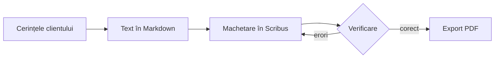
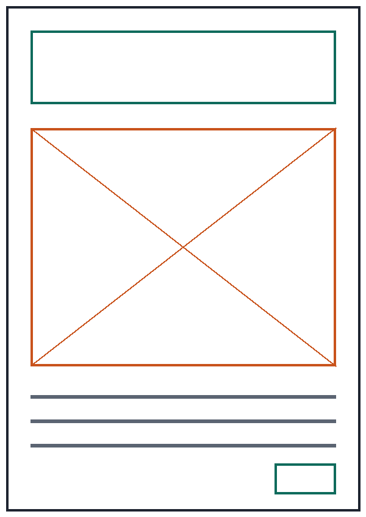

# Afiș „Ziua Porților Deschise”

Document de proiect pentru afișul A3 al liceului. Fișierul descrie **cerințele clientului**, datele tehnice, etapele de lucru și verificarea finală.

## 1. Cerințele clientului

- Format **A3**, orientare verticală (portret).
- Afișul se tipărește și se publică și pe pagina liceului.
- Termen de predare: **16 octombrie 2026**.

> **Atenție:** sigla liceului se folosește numai în varianta vectorială (SVG), niciodată copiată dintr-o captură de ecran.

## 2. Date tehnice

| Element           | Tipar          | Ecran       |
|:------------------|:--------------:|------------:|
| Dimensiune        | 297 × 420 mm   | 1080 × 1527 px |
| Rezoluție         | 300 dpi        | 96 dpi      |
| Model de culoare  | CMYK           | RGB         |
| Format de predare | PDF/X-4        | PNG         |

Imaginea de fundal trebuie să aibă cel puțin 3508 × 4961 px[^pixeli].

Numărul de pixeli necesar pe o latură:

$$N = \frac{L \cdot R}{25,4}$$

unde:

- $N$ – numărul de pixeli pe latura respectivă;
- $L$ – lungimea laturii, în milimetri (mm);
- $R$ – rezoluția, în puncte pe inch (dpi);
- $25,4$ – numărul de milimetri dintr-un inch.

## 3. Etape de lucru

- [x] Notarea cerințelor clientului
- [x] Scrierea textului afișului
- [ ] Alegerea fonturilor și a culorilor
- [ ] Machetarea în Scribus
- [ ] Verificarea (preflight) și exportul PDF



## 4. Schița afișului



## 5. Textul afișului

1. Titlu: ~~Ziua Ușilor Deschise~~ **Ziua Porților Deschise**
2. Data și ora: 24 octombrie 2026, ora 10:00
3. Adresa paginii: <https://www.exemplu.ro>

## 6. Comenzi de conversie

```bash
pandoc exemplu-avansat.md -o exemplu-avansat.docx
pandoc exemplu-avansat.md -s --mathml -o exemplu-avansat.html
```

[^pixeli]: Valoarea rezultă din formula de mai jos: 297 mm · 300 dpi / 25,4 ≈ 3508 px și 420 mm · 300 dpi / 25,4 ≈ 4961 px.
